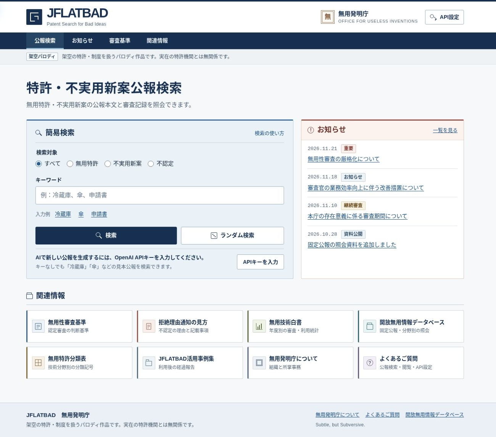

# JFLATBAD

**Patent Search for Bad Ideas**  
無用発明庁 特許・不実用新案公報検索  
*Subtle, but Subversive.*

無用発明庁が、効果の有用性と無用性の進歩性を審査する架空公報の検索サイトです。実在の特許機関とは無関係のパロディ作品です。



## 起動

展開後、`dist/index.html` をブラウザで開くと、見本公報をすぐに検索できます。最初は「冷蔵庫」を検索し、一覧から一件開いてください。ランダム検索には入力が不要です。

HTTPでローカル起動する場合は、Node.js 20以降で次を実行します。追加のパッケージは不要です。

```sh
npm run dev
```

[http://127.0.0.1:8788/](http://127.0.0.1:8788/) を開きます。`src/` を編集したら `npm run build` を実行し、ブラウザを再読み込みします。

## AI生成とAPI設定

キーなしの検索は収録済みの見本が対象です。指定した語に対応する見本がない場合は、「APIキーを入力」から設定を開き、同じ条件でAI生成を始められます。

1. 画面上部の「API設定」を開きます。
2. 自分のOpenAI APIキーを入力し、モデルを選びます。初期値は GPT-5.4 mini で、GPT-5.4 nano に切り替えられます。
3. 「接続確認」で選んだモデルの照会可否を確認できます。「このページで使う」を選ぶと、以後のキーワード検索とランダム検索で公報を新規生成します。
4. 「キーを削除」を押すかページを閉じると、キーが解除されます。キーなしで見本公報の検索に戻れます。

公報は4件ずつ、計8件の取得を試みます。応答に含まれている有効な公報を保持し、形式の不備で足りない場合だけ、不足分を最大4件、1回だけ追加で取得します。揃った分は一覧・詳細から閲覧でき、引用先が揃わなければ関連する見本公報を案内します。利用料金はキーの所有者にかかり、追加取得もAPI利用に含まれます。

見本公報29件には、部品番号と符号一覧が付いた図面を収録しました。AI生成公報でも、同じ応答で本文と図面を作成します。図面の「拡大表示」を選ぶと、スマホでも拡大して確認できます。v0.1.0で生成済みの公報には図面データがないため、図面付きの公報を取得するには再検索してください。

ブラウザから送信する接続先は `https://api.openai.com` です。運営側の中継サーバーや分析サービスは設けていません。キーはページのメモリだけに保持し、生成した公報は同じタブのセッションに直近12回分を保持します。検索語はブラウザの履歴・URLに含まれます。個人情報や機密情報は入力しないでください。

OpenAIは一般にAPIキーをクライアント側で扱わない構成を推奨しています。このMVPの直接通信は、利用者が選択して設定するBYOK機能です。試す場合は、この用途専用の制限付きプロジェクトキーを推奨します。HTMLを直接開いてAPIに接続できない環境では、HTTPでローカル起動してください。

- [OpenAI APIキーの安全性](https://help.openai.com/ja-jp/articles/5112595-best-practices-for-api-key-safety)
- [OpenAI APIの利用料金](https://openai.com/api/pricing/)

## GitHubとCloudflare Pagesへの公開

このリポジトリをCloudflare Pagesに接続する場合は、以下の設定で配信できます。

1. GitHubにリポジトリを用意し、このフォルダーを `main` ブランチに登録します。 `src/`、`tools/`、`dist/`、`package.json`、このREADMEが対象です。
2. Cloudflareダッシュボードの **Workers & Pages** から **Pages → Connect to Git** を選び、リポジトリを指定します。
3. Production branchを `main`、フレームワークを **None**、ビルドコマンドを `npm run build`、ビルド出力ディレクトリを `dist` にします。OpenAI APIキーなどの環境変数は不要です。
4. 生成されたURLでトップ、`/info/standards`、`/publication/cold-4281` を開き、直にアクセスしても表示できることを確認します。Cloudflare PagesのSPA配信を利用するため、`dist/` に `404.html` を追加しないでください。

[Cloudflare PagesのGit連携手順](https://developers.cloudflare.com/pages/get-started/git-integration/) · [SPAの配信仕様](https://developers.cloudflare.com/pages/configuration/serving-pages/#single-page-application-spa-rendering)

GitHub Pagesでも試す場合は、`dist/index.html` を公開ディレクトリの `index.html` に配置します。標準の `*.github.io` ドメインでは、サブディレクトリでも使えるハッシュ形式に自動で切り替わります。Cloudflare Pagesでは通常のパス形式を使います。

## 確認済みの動作

- PC幅とスマホ幅（390px・320px）のChromeで検索、絞り込み、一覧と公報の往復を確認。
- 「冷蔵庫」8件、ランダム検索、結果0件からの再検索、関連8ページとお知らせ4件を確認。
- ダミーキーによるOpenAIの認証エラー表示、キーの設定・削除・再読み込み時の解除を確認。
- 模擬API応答で生成8件の表示、形式不一致からの再取得、公報詳細と引用、同じ検索語での再生成を確認。有効なキーによる実生成とスマホ実機での試験は未実施。
- v0.1.1で、固定見本29件の図面、図面の拡大表示、模擬API応答からの図面表示を確認。
- v0.1.3で、途中で切れた応答や図面の不備がある場合に、取得済みの公報を保持することを確認。`npm test` で模擬応答を使った確認を実行できます。
